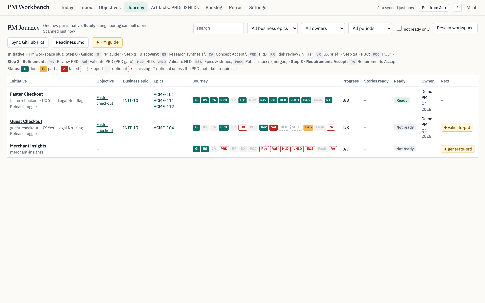
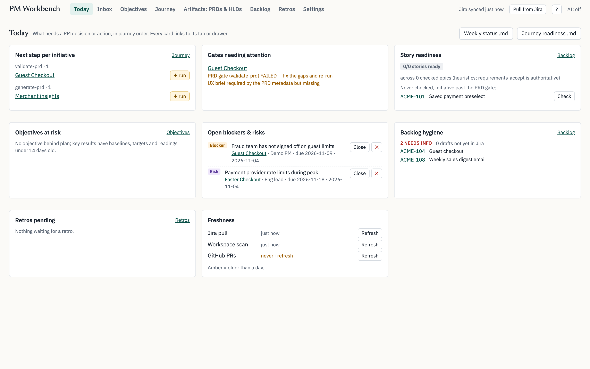
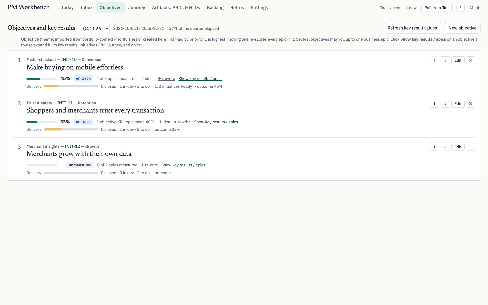
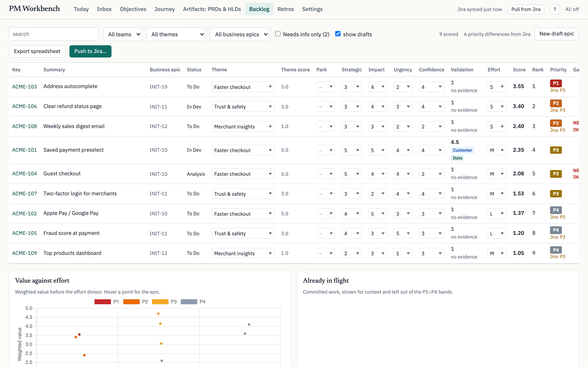
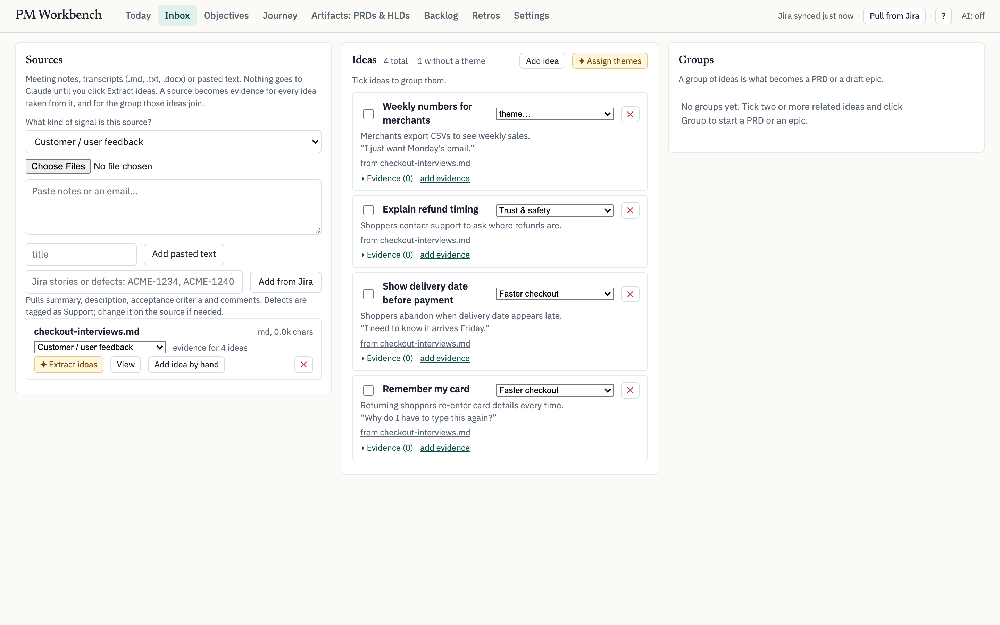

# PM Workbench

**A local cockpit for product managers: ideas → objectives → PRDs → gated epics and stories → Jira → OKRs → retros.**
Jira stays the source of truth, documents live as plain markdown files, and Claude Code does the drafting
and reviewing through bundled skills — only when you click.



## Why

A PM's week is split across Jira, a prioritization spreadsheet, a folder of PRDs, an OKR deck and a dozen
chat threads. None of them answers the questions that matter on a Monday morning:

- Which initiatives are actually ready for engineering, and what is blocking the rest?
- Is the backlog ranked by value, or by who asked last?
- Are the things we shipped moving the metrics we promised?

PM Workbench pulls those threads into one page and adds two quality gates — a **PRD gate** and a
**story Definition of Ready** — so work only reaches engineering once it is clear, measurable and right-sized.

## What it does

| Tab | What you get |
|---|---|
| **Today** | Next step per initiative, failed gates, open blockers and risks, objectives behind plan, backlog hygiene, data freshness. Weekly status report as Markdown in one click. |
| **Inbox** | Drop in interview notes, docs or Jira tickets; Claude extracts ideas and clusters them into themes; group ideas → PRD or draft epic. Every idea carries its *evidence* (usage data, customer, support, competitor…). |
| **Objectives** | Themes as OKR objectives with key results (baseline → current → target), health vs time elapsed in the quarter, and delivery progress alongside outcome progress. |
| **Journey** | One row per initiative, one chip per step from discovery to Requirements Accept, with the next step one click away. |
| **Artifacts** | Every PRD and HLD in the workspace with its review / validation state and linked epics. |
| **Backlog** | Weighted scoring matrix (strategic value, user impact, urgency, theme priority, confidence, validation evidence ÷ effort) → rank and P1–P4. Diff against Jira and push priorities and rank back. |
| **Retros** | Opens automatically when an epic closes: lifecycle, scope change, key results at release / +30 / +60 / +90 days, and a drafted summary. |

| | |
|---|---|
|  |  |
|  |  |

## Try it in one minute (demo data, no Jira needed)

```sh
git clone https://github.com/reidabook/pm-workbench && cd pm-workbench
./run.sh --demo          # seeds a fictional "Acme Shop" team, then serves http://127.0.0.1:8765
```
Windows: `.\run.ps1 --demo`. Requirements: Python 3.9+.

## Use it with your team's Jira

1. `./run.sh` and open **Settings**.
2. Set the Jira base URL and project key. **Jira Cloud:** add your Atlassian email and put an
   [API token](https://id.atlassian.com/manage-profile/security/api-tokens) in `data/.env` as
   `JIRA_API_TOKEN=…`. **Jira Server / Data Center:** leave the email empty and use a personal access token.
3. Optional: custom field ids (acceptance criteria, outcome, story points, team), a parent project for
   initiatives, or your own epic JQL.
4. Click **Create workspace** (default `~/pm-workspace`), then **Pull from Jira**.
5. Install [Claude Code](https://claude.com/claude-code) for the AI buttons and journey skills. Without it
   everything else still works.

`data/` (database, config, token) is gitignored and never leaves your machine.

## How the PM Journey works

Each step is a Claude Code skill in [`skills/`](skills), copied into your workspace as `/pm-guide`,
`/pm-generate-prd`, `/pm-validate-prd`, … Each writes a markdown or JSON file with a fixed name and
format; the workbench scans the files to show progress. See [docs/WORKFLOW.md](docs/WORKFLOW.md).

```
guide → research → concept accept → PRD → review → PRD gate → HLD → design review
      → epics & stories → (publish specs) → Requirements Accept → Jira
```

Stories reach Jira only through the **Requirements Accept** gate, and the skill never holds your Jira
credentials: it asks the running workbench to create the issues.

## Product decisions

- **Files over forms.** PMs already write documents. Keeping every artifact as markdown in one folder means
  Claude can read an initiative's full history, git can version it, and nothing is locked in the app.
- **Jira is the source of truth.** The workbench never forks the backlog; it scores, diffs and pushes back.
- **AI on demand, with a cost preview.** Nothing calls Claude until you click; every call shows the model and
  estimated tokens first, and an `off` switch disables all of it.
- **Gates, not gatekeeping.** Steps can be skipped with a recorded reason; the cost of skipping stays visible.
- **Evidence-weighted priority.** A validation score (usage data counts more than an internal ask;
  competitor-only is capped) can feed the ranking, so "the loudest request" has to show its evidence.
- **Leading and lagging together.** Each objective shows delivery progress next to outcome progress, so
  "we shipped it" and "it worked" never get confused.

## Stack

FastAPI + SQLite + one HTML page (no build step). Jira REST v2 (Cloud and Server). `claude -p` with Haiku for
extract / cluster / draft; interactive Claude Code sessions for the journey skills.

```
app/        API, Jira sync, scoring, journey logic, workspace scanners
skills/     the 15 PM Journey skills + shared conventions
static/     the UI
scripts/    demo seed
tests/      regression suite + Playwright smoke test
docs/       workflow, full reference, screenshots
```

## Tests

```sh
python tests/validate_workbench.py      # ~220 checks, no network
pip install -r requirements-dev.txt && python -m playwright install chromium
python tests/smoke_ui.py                # browser smoke test
```

Full tab-by-tab reference: [docs/REFERENCE.md](docs/REFERENCE.md). License: MIT.
