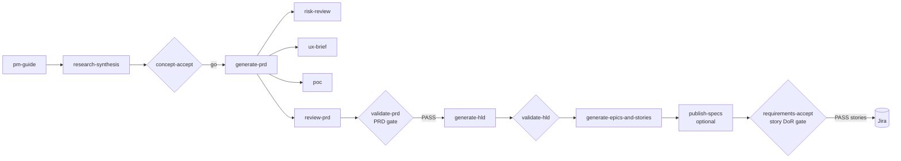

# The PM Journey

PM Workbench tracks each initiative through four phases. Each step is a Claude Code skill bundled in
[`skills/`](../skills) and copied into your workspace as `/pm-<step>`. Every skill writes a file with a known
name and format ([`skills/CONVENTIONS.md`](../skills/CONVENTIONS.md)); the workbench scans those files to
work out where each initiative stands. No database of record but the files themselves: you can edit,
re-run or skip any step.

| Phase | Step | Required | Output |
|---|---|---|---|
| 0 Guide | `pm-guide` | – | `<slug>/pm-context.md`, `refinement-plan.md` |
| 1 Discovery | `discovery`, `research-synthesis` | – | `research/` |
| | `concept-accept` | – | `concept-accepts/` (go / pivot / no-go) |
| | `generate-prd` | ✓ | `prds/` |
| | `risk-review`, `ux-brief` | when the PRD says so | `risk-reviews/`, `ux-briefs/` |
| 1a Prototype | `poc` | – | branch + `<slug>/poc.md` |
| 2 Refinement | `review-prd` | ✓ | `reviews/*_review.md` + `refined-prds/` |
| | `validate-prd` (PRD gate) | ✓ | `prd-validations/` with PASS / FAIL |
| | `generate-hld`, `validate-hld` | unless HLD Ownership = Engineering | `generated-hlds/`, `reviews/*_design_review.md` |
| | `generate-epics-and-stories` | ✓ | `epics/*.json` (nothing in Jira yet) |
| | `publish-specs` | only with `spec_repo` set | PR to the spec repo |
| 3 Requirements Accept | `requirements-accept` | ✓ | stories in Jira, `jira-manifest.json` |

**Ready** = PRD gate PASS + specs merged (when a spec repo is configured) + Requirements Accept done.
That is the point where engineering can pull stories.

## Two gates
- **PRD gate** (`validate-prd`): problem, evidence, metrics with baseline and target, testable requirements,
  non-goals, risks, rollout / backout, and the UX / Legal / HLD-ownership decisions. FAIL blocks the rest.
- **Story Definition of Ready** (`requirements-accept`): story form, Given / When / Then, five AC categories,
  ≤ 8 points, no blockers, no vague terms, AC traced to the epic's success metric. Only PASS stories are
  created in Jira, through the workbench's `/api/jira/publish-epics` endpoint (the skill never sees your token).

The Backlog tab also runs a faster, heuristic version of the DoR check on stories already in Jira.

## Why files, not a form
PMs already write in documents. Keeping every artifact as a markdown file in one folder means Claude can read
the whole history of an initiative, git can version it, and nothing is lost if the app goes away. The
workbench adds the dashboard: what is blocked, what is next, and one click to run the next step.
